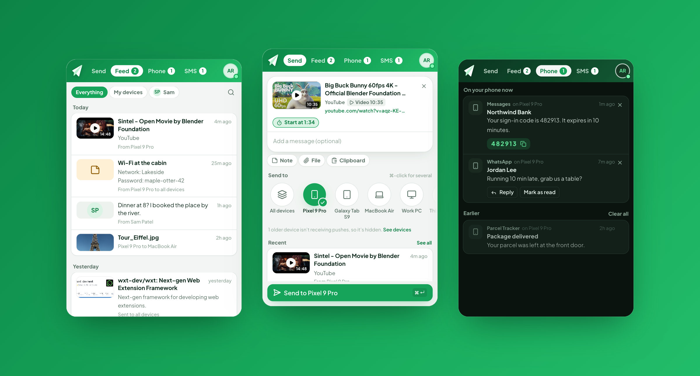
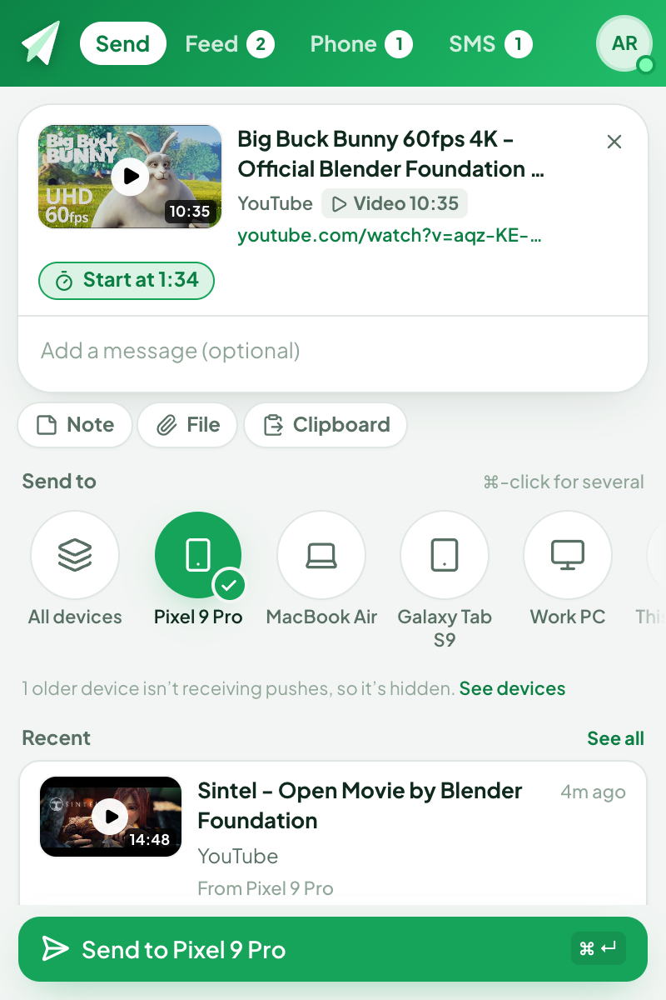
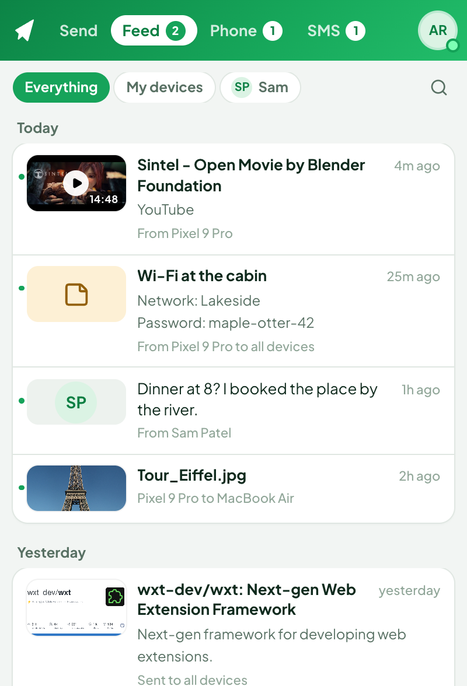
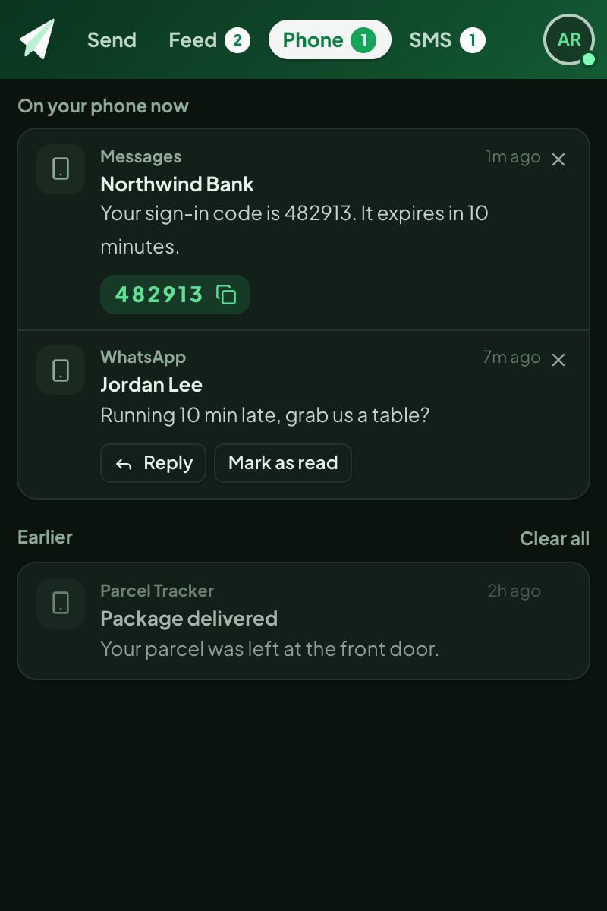
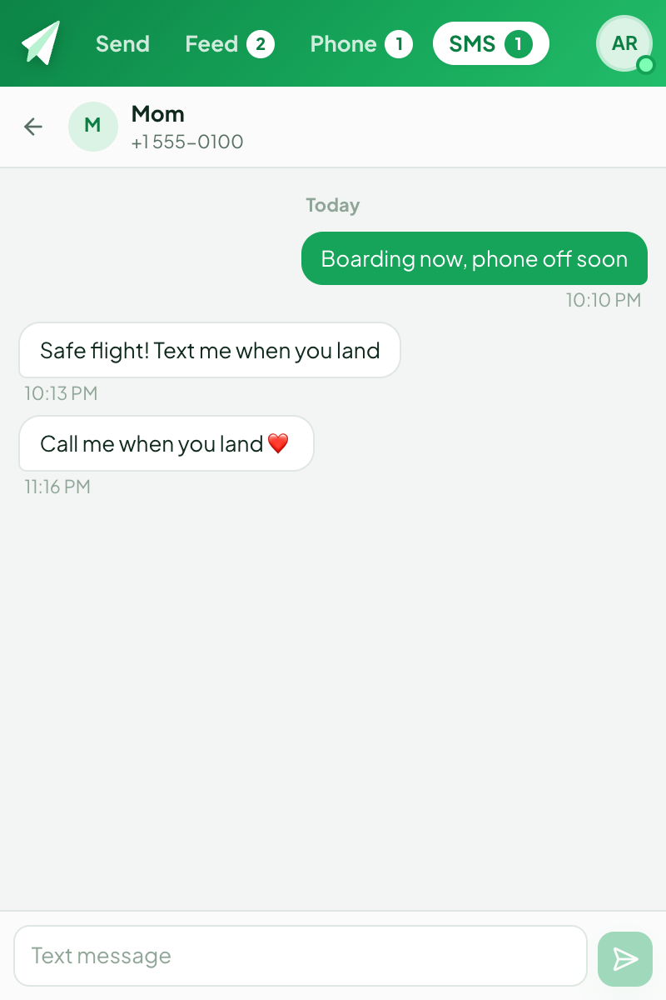

<div align="center">


# Pushpilot for Pushbullet

**Send tabs, notes and files to your phone. See your Android notifications and text from your browser.**
A fast, modern, open-source Manifest V3 client for [Pushbullet](https://www.pushbullet.com).

**[Install from the Chrome Web Store](https://chromewebstore.google.com/detail/pushpilot-for-pushbullet/pdiijobemepbckkbdeacfngodbeddmcf)** · **[Website](https://yazmani.github.io/pushpilot/)** · **[Privacy](https://yazmani.github.io/pushpilot/privacy.html)**

[](https://chromewebstore.google.com/detail/pushpilot-for-pushbullet/pdiijobemepbckkbdeacfngodbeddmcf)
[](https://github.com/yazmani/pushpilot/actions/workflows/ci.yml)
[](LICENSE)


[](https://github.com/sponsors/yazmani)
[](https://ko-fi.com/pushpilot)



</div>

> [!NOTE]
> Pushpilot is an independent, community project. It is **not affiliated with, endorsed by, or sponsored by Pushbullet** or Pushbullet Inc. "Pushbullet" is a trademark of its owner and is used here only to describe what the extension works with. You need your own Pushbullet account.

## Why

The official Pushbullet extension is built on Manifest V2, which current versions of Chrome, Brave and Edge no longer allow you to install. Pushpilot is a ground-up rewrite for Manifest V3 that keeps everything people relied on and adds what was missing, starting with sending the page you're on in one click.

## Features

**Send**
- Open Pushpilot on any page and it's ready to send as a rich card with the page's picture, title, site and kind (video with its length, article with reading time, image, code, product…).
- On YouTube, Vimeo and Twitch, **Start at 12:34** sends the link at the point you're watching.
- On an image tab, **Send the image itself** pushes the file instead of the link. Highlighted text becomes the message.
- Notes, links and files, with paste and drag-and-drop. Send to one device, several (hold `⌘`/`Ctrl`), all of them, a friend, or "This browser" to save for later.
- Right-click any page, link, image or selection to push it. Keyboard shortcuts for opening Pushpilot and pushing the current page.
- **From any app:** copy something and press `⌘⇧9` (`Ctrl+Shift+9`) to push it to your default device, or `⌘⇧8` to open Pushpilot in a window. They work while the browser is in the background. On iPhone, iPad and Mac there's also a [Pushpilot shortcut](#push-from-outside-the-browser) for the Share sheet.

**Receive**
- Real-time over Pushbullet's stream, with desktop notifications and four built-in sounds (or your own).
- Links, images, PDFs and other files open in a new tab as they arrive, like the original extension. Optionally switch to the tab, include links from friends, or catch up on what arrived while you were offline.
- Choose what counts: pushes to this browser, to all devices, to your other devices, or sent from here.
- Each browser registers its own Pushbullet device ("Brave on macOS"), so pushes between your browsers just work.

**Feed**
- Everything you've sent and received, grouped by day and searchable, with video thumbnails, images and link previews.
- Filter by your devices, channels or a friend. Picking a friend opens a chat view.

**Phone** (Android notification mirroring)
- Your phone's notifications on your desktop, with one-click copy for sign-in codes (or copy them automatically).
- Reply to messaging apps, run notification actions, and dismiss on the phone.

**SMS** (Android)
- Read conversations and send texts from your browser.

**Also**
- End-to-end encryption compatible with the Pushbullet apps, universal copy and paste, snooze, a side panel that follows your tab, a pop-out window, light and dark themes, unread badge.

| Send | Feed | Phone | SMS |
| --- | --- | --- | --- |
|  |  |  |  |

<sub>Screenshots use a fictional demo account. Videos shown are Blender Foundation open movies.</sub>

## Install

- **[Chrome Web Store](https://chromewebstore.google.com/detail/pushpilot-for-pushbullet/pdiijobemepbckkbdeacfngodbeddmcf):** one click, with automatic updates. Works in Chrome, Brave and Edge.
- **From a release:** download the latest `pushpilot-*-chrome.zip` from [Releases](https://github.com/yazmani/pushpilot/releases), unzip it, open `chrome://extensions` (or `brave://extensions`, `edge://extensions`), turn on **Developer mode**, click **Load unpacked** and pick the unzipped folder.
- **From source:** see [Development](#development).

Requires Chrome 127 or newer (or a browser based on it).

## Getting started

1. Click the Pushpilot icon and choose **Sign in with Pushbullet**, then approve Pushpilot on Pushbullet's page. You can revoke access any time at pushbullet.com › Settings.
2. Or paste an access token from [pushbullet.com › Settings › Account](https://www.pushbullet.com/#settings/account).
3. Open Pushpilot on any page, pick a device, press `⌘ Enter` / `Ctrl Enter`.

## Push from outside the browser

**From any app on your computer.** Copy a link, some text or an address anywhere and press `⌘⇧9` (`Ctrl+Shift+9` on Windows and Linux) to push it to your default device (**Settings › Sending**). `⌘⇧8` opens Pushpilot in a window over whatever you're doing, ready for files dropped onto it. The browser has to be running. To change the keys, open `chrome://extensions/shortcuts` (or `brave://…`) and keep the scope on **Global**.

**From iPhone, iPad and Mac, with the Pushpilot shortcut.** It runs in Apple's Shortcuts app, so it works without the browser.

1. [Download Pushpilot.shortcut](https://yazmani.github.io/pushpilot/Pushpilot.shortcut) and open it.
2. Paste an access token from [pushbullet.com › Settings › Account](https://www.pushbullet.com/#settings/account).
3. Optionally type the one device (or friend) it should always push to. Otherwise it asks each time.
4. The first time it runs, Shortcuts asks to let it connect to api.pushbullet.com. Choose **Allow**.

Then share a link, text, photo or file to **Pushpilot** and pick a device or friend. The place you pushed last is at the top of the list, photos go as JPEG, and with nothing shared it pushes the clipboard.

- **iPhone and iPad:** the Share sheet in any app, "Hey Siri, Pushpilot", a Home Screen icon, or Back Tap (Settings › Accessibility › Touch) to push whatever you copied.
- **Mac:** the Share menu, Finder's Quick Actions and the Services menu. In the Shortcuts app, **Details › Add Keyboard Shortcut** gives it a key, and **Pin in Menu Bar** puts it there.

Your copy keeps the access token inside it, so share the download link above rather than your copy. The shortcut talks only to Pushbullet; it's generated by [scripts/shortcut.mjs](scripts/shortcut.mjs).

## Privacy

Pushpilot has no servers, no analytics and no tracking. It talks only to Pushbullet's API and, if you turn on link previews, to the pages your links point to. Your history stays in your browser. Read the full [privacy policy](PRIVACY.md).

<details>
<summary>Why each permission is needed</summary>

| Permission | Used for |
| --- | --- |
| `storage`, `unlimitedStorage` | Your settings and local history of pushes, notifications and texts |
| `notifications` | Desktop notifications for pushes, phone notifications and texts |
| `tabs`, `activeTab`, `scripting` | Reading the page you're on (title, link, preview, video position) when you open Pushpilot; following the active tab in the side panel |
| `contextMenus` | The right-click "Push this page / link / image / selection" menu |
| `identity` | Signing in through Pushbullet's own authorization page (OAuth) |
| `alarms` | Reconnecting to Pushbullet's stream if the connection drops |
| `offscreen` | Playing the notification sound and writing to the clipboard (service workers have no DOM) |
| `clipboardRead`, `clipboardWrite` | Universal copy and paste, and copying sign-in codes |
| `sidePanel` | Opening Pushpilot in the side panel |
| `favicon` | Showing site icons next to links |
| Pushbullet hosts | The Pushbullet API, realtime stream and file storage |
| `i.ytimg.com`, `youtube.com/oembed`, `opengraph.githubassets.com` | Video thumbnails, video titles and GitHub link cards |
| All sites (optional) | Only if you turn on link previews: reading the title and image of links in your feed |

</details>

## FAQ

**A push didn't reach my phone.** Check **Settings › Devices**. Pushbullet keeps old registrations around as "not connected"; pushes to them are accepted but never delivered. Open the Pushbullet app on the phone to reconnect it.

**I pushed to "All devices" and this browser didn't get it.** Pushbullet doesn't deliver a push back to the device that sent it. Turn on **Settings › Receiving › Pushes you send from this browser** if you want that.

**Pushes from my phone don't show up here.** On the phone, pick this browser or "All devices". If the phone still lists the old Pushbullet extension as "Chrome", tick it under **Settings › Receiving › Pushes sent to another browser** and those pushes arrive here too.

**Texts don't appear as phone notifications.** When SMS sync is on in the Pushbullet app, Pushbullet sends texts through its SMS channel instead of notification mirroring. They show up in the SMS tab and as text alerts. Turn SMS sync off on the phone if you'd rather get them as mirrored notifications.

**Do phone notifications and SMS work on iPhone?** No. Pushbullet supports notification mirroring and SMS on Android only.

**Universal copy and paste doesn't do anything.** It needs Pushbullet Pro and the setting turned on in your other Pushbullet apps.

**Sending stopped working with an error.** Free Pushbullet accounts can send 500 pushes a month; going over makes sends fail until the next month or until you upgrade to Pushbullet Pro. Receiving, phone notifications and SMS aren't affected.

## Development

Built with [WXT](https://wxt.dev), React 19, TypeScript and Tailwind CSS 4.

```bash
npm install
npm run dev          # Chrome with the extension and hot reload
npm run build        # production build in dist/chrome-mv3
npm run zip          # store-ready zip in dist/
npm run compile      # type-check
npm test             # unit tests
npm run format       # Prettier
npm run screenshots  # README screenshots from the demo account (store images go to the git-ignored .local/)
```

### Testing against a real account

Put a Pushbullet access token in `.env` (git-ignored, never bundled):

```
ACCESS_TOKEN=o.xxxxxxxx
```

```bash
npm run test:api   # checks every Pushbullet endpoint Pushpilot uses (add -- --send to create and delete a test push)
npm run test:e2e   # loads the built extension in Chrome for Testing, signs in, sends, uploads, receives, screenshots each view
```

The end-to-end run only pushes to the test browser's own device, deletes everything it created, and removes that device afterwards. Screenshots go to `e2e-shots/` (git-ignored, since they contain your real data). See [docs/TESTING.md](docs/TESTING.md) for what is and isn't covered.

### Architecture

```
src/
  pages/            every extension context (WXT entrypoints): background, popup, sidepanel, options, offscreen
  core/             shared by every context, no UI: Pushbullet client + E2E crypto, typed storage, RPC contracts, utils
  background/       service worker: services/ (auth, stream, pushes, mirror, sms, send, previews) and platform/ (notifications, menus, badge, commands, windows, offscreen)
  ui/               React: app/ shell, features/ (send, feed, phone, sms, auth, settings), components/, hooks/, styles/
scripts/            icons, live API check, end-to-end suite, screenshots
tests/              unit tests (Vitest)
```

The worker owns the network: it syncs, listens to the stream and writes to `chrome.storage.local`. The UI renders from storage and asks the worker to act through typed RPC (`src/core/messaging/rpc.ts`). File uploads run in the UI so they can show progress.

## Support

Pushpilot is free and open source, with no ads and no tracking, and it stays that way. If it saves you time, you can help keep it going:

- ☕ [Buy me a coffee on Ko-fi](https://ko-fi.com/pushpilot)
- 💚 [Sponsor on GitHub](https://github.com/sponsors/yazmani)
- ⭐ [Leave a review in the Chrome Web Store](https://chromewebstore.google.com/detail/pushpilot-for-pushbullet/pdiijobemepbckkbdeacfngodbeddmcf/reviews), or star this repository

### Supporters

Thank you to everyone who keeps Pushpilot going 💚 Supporters who'd like to be listed here can reply to their Ko-fi thank-you message or mention it on GitHub Sponsors.

<!-- supporters:start -->
<!-- supporters:end -->

## Contributing

Issues and pull requests are welcome. Please read [CONTRIBUTING.md](CONTRIBUTING.md) first. Security issues: see [SECURITY.md](SECURITY.md).

## License

[AGPL-3.0](LICENSE). If you distribute a modified version, including as a hosted service, you must share its source under the same license.

## Acknowledgements

- [Pushbullet](https://www.pushbullet.com) for the service and its API.
- [Blender Foundation](https://www.blender.org/about/projects/) open movies, used in the screenshots.
